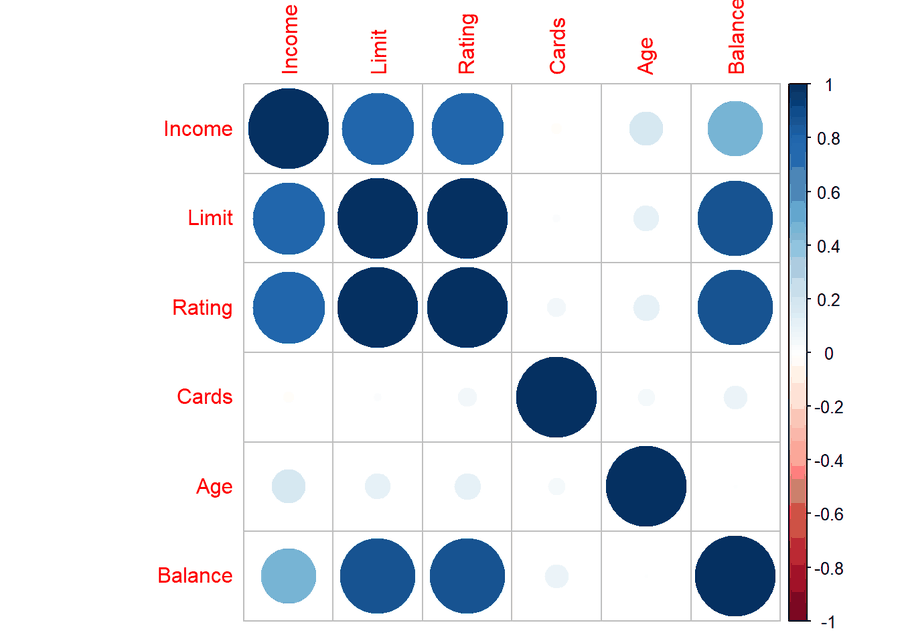
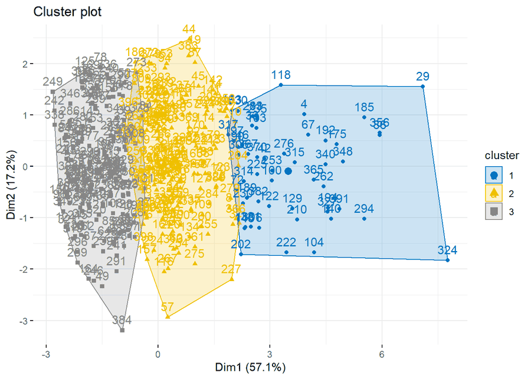

# Çok Değişkenli İstatistiksel Analiz Yöntemleri

Çok değişkenli istatistiksel analiz yöntemlerinin kredi kartı kullanım verisi üzerinde R ile
uygulanması. Aynı analizlerin SAS kodu da repoda yer alır.

*Multivariate statistical analysis methods applied to credit card data in R, with the equivalent SAS code.*

**Rapor:** [`Kredi/credit.pdf`](Kredi/credit.pdf) (GitHub'da doğrudan açılır) veya
[`Kredi/credit.html`](Kredi/credit.html) dosyasını indirip tarayıcıda aç.




## İçerik

1. Normallik varsayımının kontrolü
2. Tek yönlü MANOVA (Multivariate Analysis of Variance)
3. Çift yönlü MANOVA
4. Temel Bileşenler Analizi (Principal Component Analysis, PCA)
5. Faktör Analizi (Factor Analysis)
6. Diskriminant Analizi (Discriminant Analysis)
7. Lojistik Regresyon (Logistic Regression)
8. Çoklu Lojistik Regresyon (Multinomial Logistic Regression)
9. Kümeleme Analizi (Cluster Analysis): hiyerarşik ve K-means

## Dosyalar

| Dosya | Açıklama |
|---|---|
| `Kredi/credit.Rmd` | R Markdown kaynak dosyası |
| `Kredi/credit.html`, `Kredi/credit.pdf` | Derlenmiş rapor |
| `Kredi/sas.txt` | Aynı analizlerin SAS kodu (`proc glm`, `proc factor`, `proc discrim`, `proc logistic`, `proc cluster`, `proc fastclus`) |

## Çalıştırma

```r
rmarkdown::render("Kredi/credit.Rmd")
```

Veri dosyası (`credit.sav`) repoda yok. Veriyi aşağıdaki adresten indirip `credit.Rmd` içindeki
`read_sav()` satırındaki yolu kendi dosyana göre güncelle.

Kullanılan başlıca paketler: `MASS`, `car`, `psych`, `rstatix`, `factoextra`, `cluster`, `corrplot`,
`GGally`, `klaR`, `nnet`, `mlogit`.

## Veri

Credit veri seti: James, Witten, Hastie, Tibshirani, *An Introduction to Statistical Learning*,
https://statlearning.com/data.html

Değişkenler: gelir, limit, kredi notu, kart sayısı, yaş, eğitim, cinsiyet, öğrencilik durumu,
medeni durum, etnik köken, bakiye.
